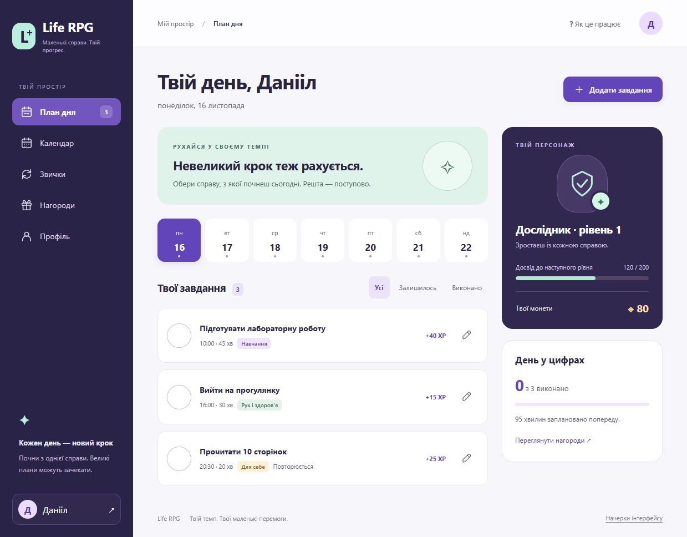
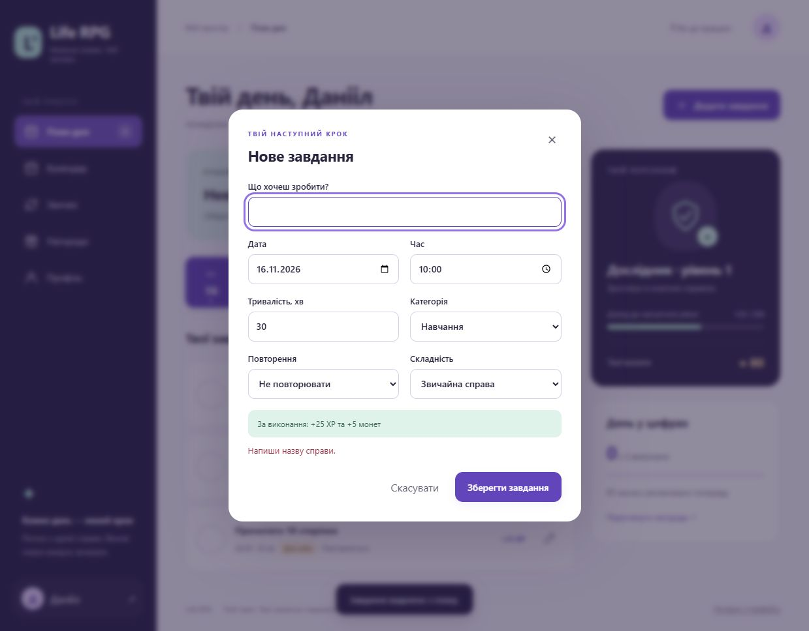
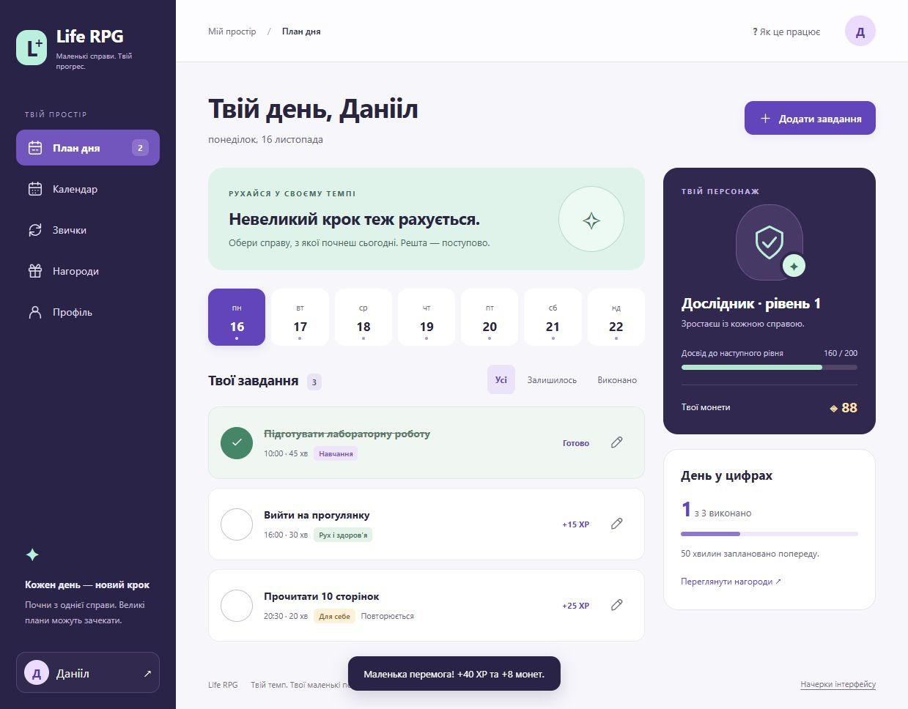
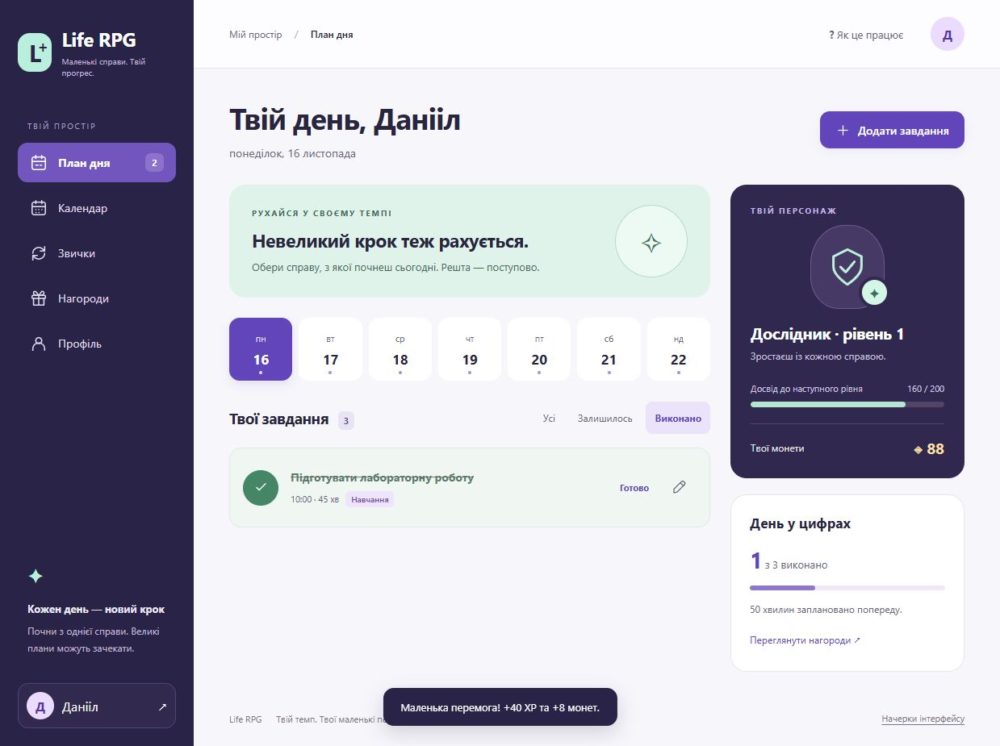
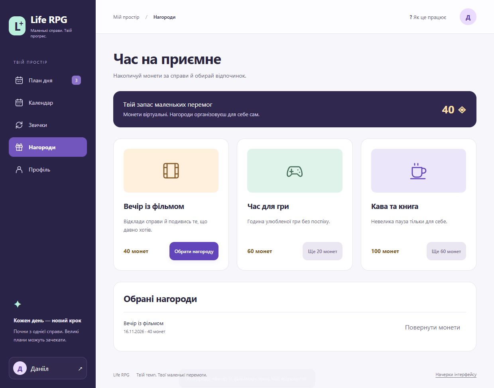

# Практична робота №3 - Написання тест-кейсів

**Слуцьковський Данііл Андрійович, 121-23-2.**

[PDF-звіт](report.pdf) · [Структуровані тест-кейси](test-cases.json) · [Копія прототипу](app/)

## Об’єкт

Life RPG - особистий планувальник із сімома частинами: навігація, форма завдання, календар і повторення, фільтри, прогрес, нагороди, профіль і локальне збереження.

## Прогін 16.11.2026

Локальна копія, настільний Chromium у вбудованому браузері; http://127.0.0.1:8768; 1254×883 CSS px.

B0: D0=16.11.2026, D1=17.11.2026; План дня, фільтр Усі; 3 початкові невиконані справи; 120 XP, 80 монет; покупок немає; профіль Данііл.

Усі початкові справи, винагороди й правила описані в PDF. Кожен кейс готує власні передумови та відновлює базовий стан; залежності від інших кейсів немає.

**14 PASS / 0 FAIL / 0 BLOCKED.** Перевірено вибрані сценарії локальної версії; результат не є твердженням про відсутність усіх дефектів.

Негативний тип тесту не дорівнює статусу FAIL. TC-03, TC-04 і TC-11 пройшли, бо некоректна дія очікувано відхиляється.

## Тест-кейси

### TC-01. Перехід до календаря

**Пріоритет:** Medium · **Тип:** Positive · **Компонент:** Навігація · **Статус:** PASS

**Передумови:** Базовий стан B0 (описаний перед тест-кейсами). Відкрито «План дня».

**Кроки:**

1. Натиснути «Календар» у меню.

**Очікувано:** Відкривається екран із заголовком «Календар» та сіткою поточного місяця.

**Фактично:** Відкрився екран «Календар» із сіткою місяця.

**Постумови:** Повернутися до «План дня».

### TC-02. Створення справи з коректними даними

**Пріоритет:** High · **Тип:** Positive · **Компонент:** Форма завдання · **Статус:** PASS

**Передумови:** Базовий стан B0 (описаний перед тест-кейсами). Тестової справи ще немає.

**Кроки:**

1. Натиснути «Додати завдання».
2. Ввести «TC-02 Підготувати звіт»; дата D0, 10:00, 30 хв, навчання, без повторення, середня складність.
3. Натиснути «Зберегти завдання».

**Очікувано:** У плані D0 є нова справа з назвою, часом 10:00 і тривалістю 30 хв; у картці показано +25 XP.

**Фактично:** TC-02 Підготувати звіт; 10:00 · 30 хв; Навчання; +25 XP

**Постумови:** Видалити лише «TC-02 Підготувати звіт» через редагування та підтвердження.

### TC-03. Відхилення назви з пробілів

**Пріоритет:** High · **Тип:** Negative · **Компонент:** Форма завдання · **Статус:** PASS

**Передумови:** Базовий стан B0 (описаний перед тест-кейсами). Відкрито порожню форму додавання.

**Кроки:**

1. У назву ввести три пробіли; інші поля залишити типовими.
2. Натиснути «Зберегти завдання».

**Очікувано:** Форма залишається відкритою, показано «Напиши назву справи.».

**Фактично:** Форма залишилася відкритою; повідомлення: Напиши назву справи.

**Постумови:** Натиснути «Скасувати».

### TC-04. Тривалість нижча за мінімум

**Пріоритет:** High · **Тип:** Negative / boundary · **Компонент:** Форма завдання · **Статус:** PASS

**Передумови:** Базовий стан B0 (описаний перед тест-кейсами). Відкрито форму додавання; мінімум тривалості - 5 хв.

**Кроки:**

1. Ввести назву «TC-04 Межа тривалості».
2. У полі тривалості ввести 4.
3. Натиснути «Зберегти завдання».

**Очікувано:** Збереження зупиняється, форма не закривається; поле 4 хв має порушення нижньої межі (rangeUnderflow).

**Фактично:** Форма не закрилася; тривалість 4 хв, min=5, rangeUnderflow=true

**Постумови:** Натиснути «Скасувати».

### TC-05. Зміна назви наявної справи

**Пріоритет:** Medium · **Тип:** Positive · **Компонент:** Редагування завдання · **Статус:** PASS

**Передумови:** Базовий стан B0 (описаний перед тест-кейсами). Є невиконана справа «Вийти на прогулянку», 16:00, 30 хв.

**Кроки:**

1. Відкрити редагування «Вийти на прогулянку».
2. Змінити лише назву на «Прогулянка 30 хвилин».
3. Зберегти завдання.

**Очікувано:** У картці нова назва; час 16:00 і тривалість 30 хв збережено.

**Фактично:** Прогулянка 30 хвилин; 16:00 · 30 хв; Рух і здоров’я; +15 XP

**Постумови:** Повернути початкову назву через редагування.

### TC-06. Нарахування досвіду за виконання

**Пріоритет:** High · **Тип:** Positive · **Компонент:** Прогрес · **Статус:** PASS

**Передумови:** Базовий стан B0 (описаний перед тест-кейсами). Лабораторна невиконана; її винагорода - 40 XP та 8 монет.

**Кроки:**

1. Позначити «Підготувати лабораторну роботу» виконаною.

**Очікувано:** Картка має позначку «Готово»; досвід зростає зі 120 до 160 XP, баланс - з 80 до 88 монет.

**Фактично:** Досвід 160, монети ◈88; справа має статус «Готово».

**Постумови:** Скасувати виконання цієї справи.

### TC-07. Скасування виконання справи

**Пріоритет:** High · **Тип:** Positive · **Компонент:** Прогрес · **Статус:** PASS

**Передумови:** Підготувати B0. Окремо позначити лабораторну виконаною: 160 XP, 88 монет. Нагороди не купувалися.

**Кроки:**

1. Натиснути позначку скасування виконання лабораторної.

**Очікувано:** Справа невиконана; відновлено 120 XP та 80 монет.

**Фактично:** Після скасування 120 XP та ◈80 монет; справа невиконана.

**Постумови:** Залишити B0; додаткові дії не потрібні.

### TC-08. Повторювана справа в наступний день

**Пріоритет:** High · **Тип:** Positive · **Компонент:** Календар і повторення · **Статус:** PASS

**Передумови:** Підготувати B0. Окремо виконати «Прочитати 10 сторінок» у D0: 145 XP, 85 монет. Повторення щоденне.

**Кроки:**

1. Вибрати D1 у смузі днів.
2. Перевірити позначку справи «Прочитати 10 сторінок».

**Очікувано:** У D1 справа невиконана; виконання у D0 не позначає наступний день. Досвід залишається 145 XP.

**Фактично:** 17.11 справа «Прочитати 10 сторінок» невиконана (aria-pressed=false); досвід залишився 145 XP.

**Постумови:** Повернутися до D0 і скасувати виконання читання.

### TC-09. Показ лише виконаних справ

**Пріоритет:** Medium · **Тип:** Positive · **Компонент:** Фільтри · **Статус:** PASS

**Передумови:** Підготувати B0. Окремо виконати лише лабораторну; прогулянка та читання невиконані.

**Кроки:**

1. Натиснути фільтр «Виконано».

**Очікувано:** У списку рівно одна картка - «Підготувати лабораторну роботу».

**Фактично:** У фільтрі «Виконано» показана одна справа: «Підготувати лабораторну роботу».

**Постумови:** Вибрати «Усі» та скасувати виконання лабораторної.

### TC-10. Обмін монет на доступну нагороду

**Пріоритет:** High · **Тип:** Positive · **Компонент:** Нагороди · **Статус:** PASS

**Передумови:** Базовий стан B0 (описаний перед тест-кейсами). Відкрито «Нагороди». Вартість фільму - 40 монет.

**Кроки:**

1. У картці «Вечір із фільмом» натиснути «Обрати нагороду».

**Очікувано:** Баланс зменшується з 80 до 40; в «Обрані нагороди» з’являється один запис про фільм за 40 монет.

**Фактично:** Баланс 40 ◈; в історії: Вечір із фільмом; 16.11.2026 · 40 монет; Повернути монети

**Постумови:** Натиснути «Повернути монети» для цієї нагороди.

### TC-11. Недоступна нагорода за браку монет

**Пріоритет:** High · **Тип:** Negative · **Компонент:** Нагороди · **Статус:** PASS

**Передумови:** Базовий стан B0 (описаний перед тест-кейсами). Відкрито «Нагороди»; «Кава та книга» коштує 100 монет.

**Кроки:**

1. Перевірити стан кнопки в картці «Кава та книга».

**Очікувано:** Кнопка вимкнена та має текст «Ще 20 монет»; вибір цієї нагороди через кнопку недоступний.

**Фактично:** За балансу 80 кнопка для нагороди вартістю 100 монет вимкнена: «Ще 20 монет».

**Постумови:** Залишити баланс 80 монет без покупок.

### TC-12. Збереження імені після перезавантаження

**Пріоритет:** Medium · **Тип:** Positive · **Компонент:** Профіль і локальне збереження · **Статус:** PASS

**Передумови:** Базовий стан B0 (описаний перед тест-кейсами). Відкрито «Профіль»; локальне сховище браузера доступне.

**Кроки:**

1. Змінити ім’я на «Тестовий користувач».
2. Натиснути «Зберегти профіль».
3. Перезавантажити сторінку та перевірити поле імені.

**Очікувано:** Після перезавантаження поле містить «Тестовий користувач».

**Фактично:** Після перезавантаження поле імені містить «Тестовий користувач».

**Постумови:** Зберегти початкове ім’я «Данііл»; мету не змінювати.

### TC-13. Повернення монет за нагороду

**Пріоритет:** Medium · **Тип:** Positive · **Компонент:** Нагороди · **Статус:** PASS

**Передумови:** Підготувати B0. Окремо обрати «Вечір із фільмом»: баланс 40 монет, один запис у нагородах.

**Кроки:**

1. Натиснути «Повернути монети» для фільму.

**Очікувано:** Баланс відновлено до 80 монет; список обраних нагород порожній.

**Фактично:** Після повернення баланс 80 ◈, записів у списку нагород: 0

**Постумови:** Залишити B0; додаткові дії не потрібні.

### TC-14. Видалення окремої справи

**Пріоритет:** High · **Тип:** Positive · **Компонент:** Видалення завдання · **Статус:** PASS

**Передумови:** Підготувати B0. Окремо створити невиконану «TC-14 Тимчасова справа» з типовими полями; у D0 чотири справи.

**Кроки:**

1. Відкрити редагування тимчасової справи.
2. Натиснути «Видалити».
3. У вікні підтвердження натиснути «Видалити завдання».

**Очікувано:** Тимчасова справа зникає; у плані залишаються три початкові справи.

**Фактично:** Тимчасова справа зникла. У плані залишилися три початкові справи.

**Постумови:** Залишити B0; видалена справа одноразова і тестова.

## Повторення перевірок

Запустіть локальний статичний сервер із папки `app` (наприклад, `python -m http.server 8768`) і відкрийте `http://localhost:8768`. Використайте окремий чистий профіль браузера. На нову поточну дату D0 демонстраційні справи створюються автоматично; D1 - наступний день. Перед кожним кейсом підготуйте B0 і його додаткові передумови. Наявні особисті дані не очищайте.

`app.js` SHA-256: `4ed68581967e98717a100d1e922588a0545d8eeafbfc649750a1ab4952ae3488`. Файли прототипу під час цього прогону не змінювалися.

## Контрольні питання

**Навіщо потрібні тест-кейси?** Для відтворюваних перевірок вимог, повторної перевірки після змін та фіксації результатів.

**Основні атрибути?** ID, назва, пріоритет, передумови, кроки, очікуваний і фактичний результати. Додатково: тип, компонент, статус, постумови.

**Які типи існують?** Позитивні й негативні; за метою - функціональні та нефункціональні. Граничні значення використовуються для вибору тестових даних.

**Що таке негативний тест-кейс?** Перевірка реакції на некоректні дані або недопустиму дію. Очікуване відхилення означає PASS.

Джерело завдання: «АПЗ_практика3_TestCase.pdf», с. 13-14.
