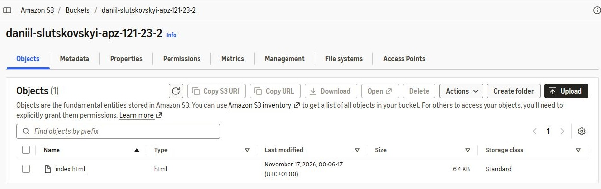
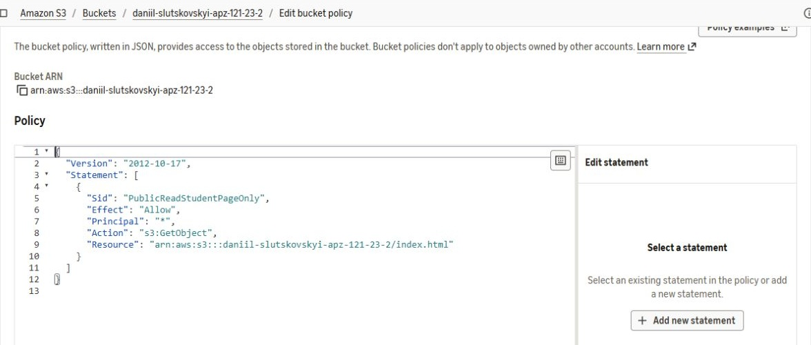
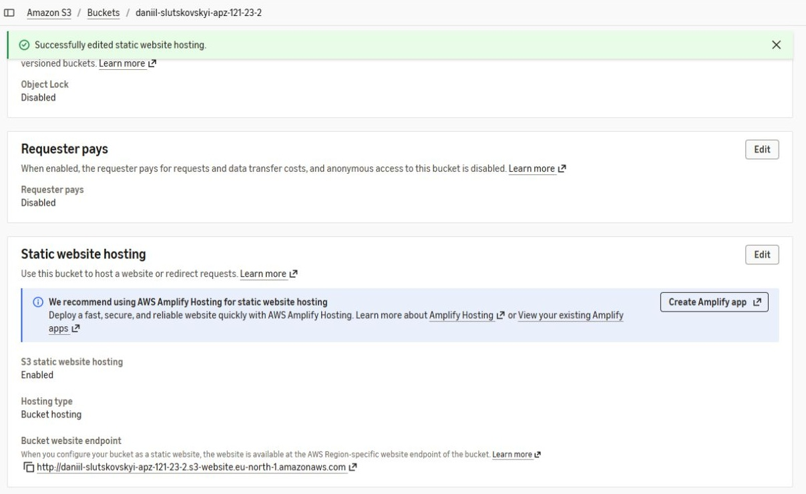
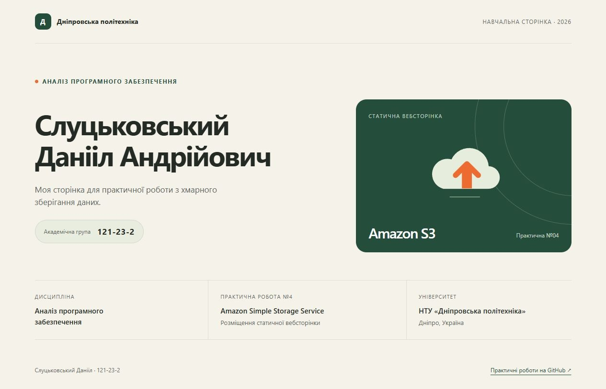

# Практична робота №4 - Amazon S3

**Слуцьковський Данііл Андрійович, група 121-23-2.**

## Результат

Статичну вебсторінку розміщено в Amazon S3. На ній вказано повне ПІБ та академічну групу.

- **Адреса сайту для викладача:** [http://daniil-slutskovskyi-apz-121-23-2.s3-website.eu-north-1.amazonaws.com/](http://daniil-slutskovskyi-apz-121-23-2.s3-website.eu-north-1.amazonaws.com/)
- **Пряма HTTPS-адреса сторінки:** [https://daniil-slutskovskyi-apz-121-23-2.s3.eu-north-1.amazonaws.com/index.html](https://daniil-slutskovskyi-apz-121-23-2.s3.eu-north-1.amazonaws.com/index.html)
- [PDF-звіт](report.pdf)

Бакет: `daniil-slutskovskyi-apz-121-23-2`. Регіон: Europe (Stockholm), `eu-north-1`. Назва містить ім’я та прізвище латиницею.

## Створення бакета й завантаження

Вхід до акаунта виконано через GitHub. Створено бакет General purpose у Global namespace. ACL вимкнено (Bucket owner enforced), шифрування SSE-S3. Файл `site/index.html` завантажено в корінь як `index.html`, Content-Type: `text/html`, розмір 6604 байти.

## Доступ

Політика дозволяє всім лише `s3:GetObject` для `index.html`. Вона не надає запису, видалення чи переліку об’єктів. У цьому бакеті BlockPublicPolicy та RestrictPublicBuckets встановлено в false; BlockPublicAcls та IgnorePublicAcls залишено true. Загальні налаштування акаунта не змінювалися.

## Хостинг

Увімкнено Static website hosting → Host a static website. Index document: `index.html`.

Website endpoint використовує HTTP. Прямий URL об’єкта S3 працює через HTTPS; це та сама сторінка, але окремий спосіб доступу.

## Перевірка 17.11.2026

| Запит без облікових даних AWS | Результат |
|---|---|
| HTTP website endpoint | 200 OK, text/html |
| HTTPS index.html | 200 OK, text/html |
| GET зі списком об’єктів через REST endpoint | 403 Forbidden |

Обидві адреси сторінки повернули HTML, що побайтово збігається з локальним файлом. Журнал перевірки й SHA-256 наведено у [verification.json](verification.json). У вбудованому браузері переглянуто HTTPS-версію; HTTP-версію перевірено окремим GET-запитом, оскільки клієнт браузера її заблокував.

## Матеріали

- [HTML сторінки](site/index.html) - стилі й ілюстрація вбудовані, додаткових залежностей немає.
- [Bucket policy](aws/bucket-policy.json).
- [Параметри Block Public Access](aws/public-access-block.json).
- [Налаштування website hosting](aws/website-configuration.json).
- Відповіді на контрольні питання містяться в PDF-звіті.

## Висновок

Підготовлено й опубліковано власну вебсторінку, увімкнено хостинг S3 та перевірено публічне читання. Викладач може відкрити сторінку без облікового запису AWS.

## Джерела

1. [AWS: Configuring a static website on Amazon S3](https://docs.aws.amazon.com/AmazonS3/latest/userguide/HostingWebsiteOnS3Setup.html).
2. [AWS: What is Amazon S3?](https://docs.aws.amazon.com/AmazonS3/latest/userguide/Welcome.html).
3. «АПЗ_практика4_AWS_S3.pdf», с. 15-20.
