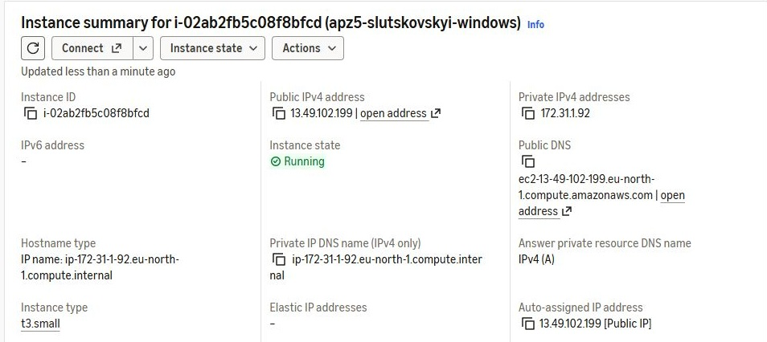
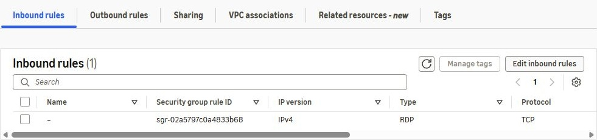
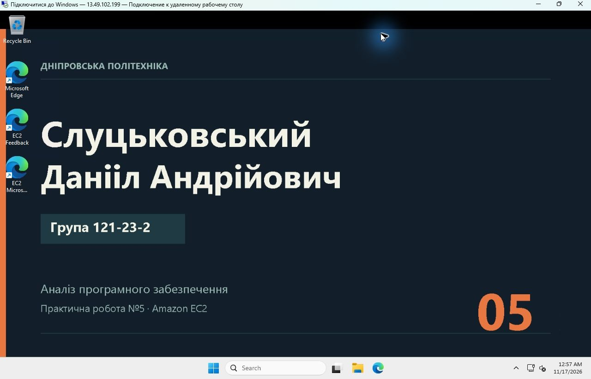

# Практична робота №5 - Windows в Amazon EC2

**Слуцьковський Данііл Андрійович, група 121-23-2.**

[PDF-звіт](report.pdf) · [Параметри інстансу](instance.json) · [Перевірки](verification.json)

## Створена машина

| Параметр | Значення |
|---|---|
| Назва | apz5-slutskovskyi-windows |
| Instance ID | i-02ab2fb5c08f8bfcd |
| ОС | Windows Server 2025 Full Base |
| Регіон | eu-north-1, Europe (Stockholm) |
| Тип | t3.small, 2 vCPU, 2 GiB RAM |
| Диск | EBS gp3, 30 GiB |
| Public IPv4 | 13.49.102.199 |
| Username | Administrator |
| Використання | On-Demand, CPU credits Standard |

## Підключення

Початковий пароль отримано через Get Windows password із відповідним RSA-ключем. Вхід виконано через RDP. Дані входу надаються викладачеві окремо приватним файлом.

Security Group: sg-0b1933922d6b3187e (launch-wizard-1). За погодженням власника для перевірки викладачем дозволено TCP 3389 із 0.0.0.0/0. Пароль потрібен для автентифікації.

## Персоналізація Windows

[wallpaper.png](wallpaper.png) містить повне ПІБ і групу. Файл підготовлено під час запуску в `C:\Users\Public\Pictures\APZ5`, потім встановлено через Set as desktop background. Режим розміщення - Fit.

## Результат перевірки 17.11.2026

- Інстанс працює, параметри відповідають обраній конфігурації.
- Вхід через RDP виконано з комп’ютера власника.
- На робочому столі видно ПІБ і групу 121-23-2.
- Правило для підключення викладача збережено в AWS. Окремий вхід викладача ще не виконувався.

Інстанс залишено Running для перевірки. Після оцінювання його слід зупинити. Після Stop/Start автоматична зовнішня адреса може змінитися. Диск EBS продовжує враховуватись і під час зупинки.

Контрольні питання та висновок наведено в PDF. Методичні вказівки: «АПЗ_практика5_AmazonEC2.pdf», с. 21-26. Офіційні джерела AWS: [RDP](https://docs.aws.amazon.com/AWSEC2/latest/UserGuide/connect-rdp.html), [Stop/Start](https://docs.aws.amazon.com/AWSEC2/latest/UserGuide/Stop_Start.html), [Terminate](https://docs.aws.amazon.com/AWSEC2/latest/UserGuide/terminating-instances.html).
